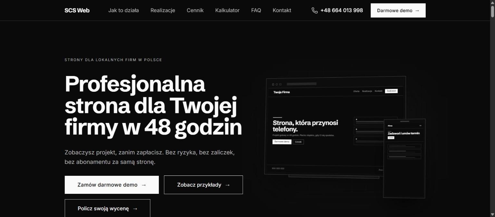
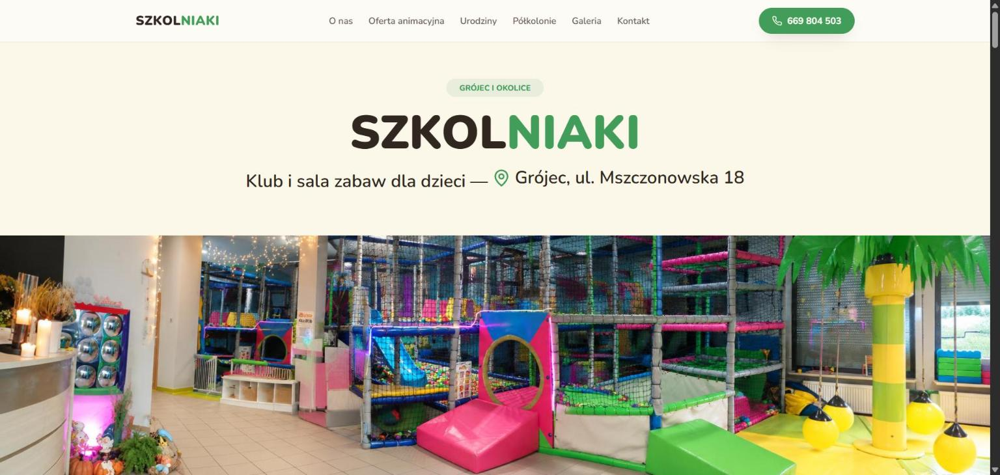
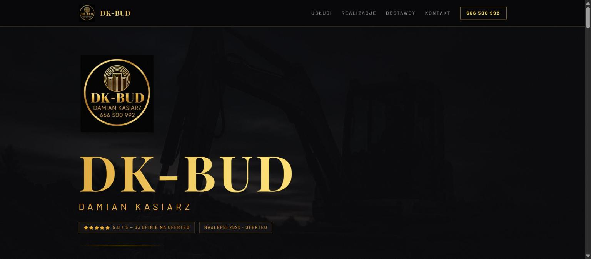

# Kamil Pietraszko

I build websites and web apps for small businesses, mostly with React, TypeScript and Tailwind CSS. I run [SCS Web](https://scsweb.pl), a one-person studio that makes websites for local companies in Poland.

## Projects with public code

### Forma – personal health and training journal

Web app for tracking diet, calories, workouts, body measurements, progress photos and medical results. Every user has a private account, and row-level security keeps each account's data separate.

- **Live demo:** [forma-health-tracker.lovable.app](https://forma-health-tracker.lovable.app) (demo account: `demo@example.com` / `FormaDemo2026`)
- **Code:** [kamils-wellness-journey](https://github.com/kamilos2410-glitch/kamils-wellness-journey)
- **Stack:** React, TypeScript, TanStack Start, Tailwind CSS, Supabase

### SCS Web – website for my web design studio

Marketing website with service, industry and local landing pages, demo websites, a pricing calculator and a contact form.

- **Live:** [scsweb.pl](https://scsweb.pl)
- **Code:** [polskie-strony-szybko](https://github.com/kamilos2410-glitch/polskie-strony-szybko)
- **Stack:** React, TypeScript, TanStack Start, Tailwind CSS, Web3Forms

## Client websites

The code of these sites stays private because it contains client materials.

### SZKOLNIAKI – children's club and playroom in Grójec

One-page website with the club's offer, a photo gallery, a map and a contact form.

- **Live:** [szkolniakigrojec.pl](https://szkolniakigrojec.pl)

### DK-BUD Damian Kasiarz – earthworks and paving company

Black-and-gold one-page website with services, a gallery of completed projects, a map and a contact form.

- **Live:** [dk-bud-kasiarz.lovable.app](https://dk-bud-kasiarz.lovable.app)

## Contact

[scsweb.pl](https://scsweb.pl) · kamil@scsweb.pl
